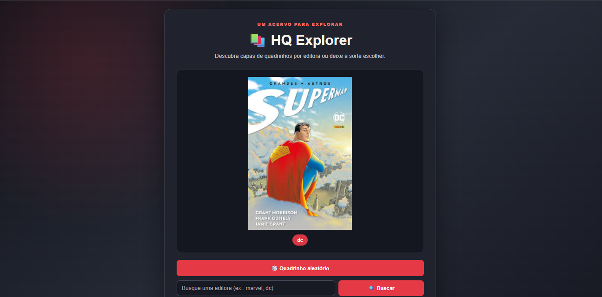

# HQ Explorer

Projeto de front-end e API em Node.js/Express para explorar capas de quadrinhos de quatro editoras. A página permite sortear uma capa ou buscar por categoria.

## Como rodar

1. No terminal, entre na pasta `backend`.
2. Execute `npm install` e depois `node server.js`.
3. Com o servidor ligado, abra `frontend/index.html` no navegador.

## Rotas da API

| Método | Rota | O que retorna |
|---|---|---|
| GET | `/api/hqs/aleatorio` | Uma capa aleatória e a categoria correspondente |
| GET | `/api/hqs/:categoria` | Uma capa aleatória da categoria informada; retorna 404 com mensagem e lista de categorias se ela não existir |

As imagens são servidas em `/fotos/...`. Por exemplo, `http://localhost:3000/fotos/dc/1.jpg`.

## Categorias disponíveis

- `marvel`
- `dc`
- `image-comics`
- `dark-horse-comics`

## Critérios de conferência das imagens

Uma resposta bem-sucedida da API não garante, sozinha, que o navegador conseguiu carregar a imagem. Antes de considerar a atividade funcionando, confira também:

- A URL `image` retornada pela API usa a rota estática `/fotos/`, que corresponde à pasta `backend/data/img/`.
- O caminho de cada arquivo no `backend/data/hq.json` aponta para um arquivo existente, inclusive respeitando maiúsculas/minúsculas e extensão.
- A URL da imagem abre diretamente no navegador e responde com status HTTP 200 e conteúdo de imagem.
- O HTML, o CSS e o JavaScript usam os mesmos IDs e classes para imagem, área de exibição e categoria.
- Se a API estiver ligada, mas a imagem não carregar, a página apresenta uma mensagem que orienta a conferir URL, rota estática e existência do arquivo.
- A busca por categoria inexistente apresenta o erro 404 retornado pela API, sem ser confundida com uma falha de carregamento de imagem.
- Ao publicar no GitHub, os arquivos de imagem e seus caminhos devem estar presentes no repositório; `node_modules` não deve ser enviado.

### Diagnóstico rápido

Se a API responde mas a imagem não aparece, verifique primeiro estes desencontros comuns: pasta física diferente da usada por `express.static`, prefixo de URL diferente entre a rota estática e a URL devolvida pela API, nomes de arquivo/pastas incorretos no JSON, arquivos ausentes ou com extensão/caixa diferente, e IDs/classes do HTML diferentes dos seletores JavaScript/CSS. No navegador, a aba Network/Console ajuda a distinguir URL 404 de falha na própria API.

## Prints para a entrega

Salve capturas reais da aplicação funcionando em `prints/` com estes nomes e incorpore-as aqui depois de criá-las:

- `prints/print1-aleatorio.png` — capa sorteada pelo botão “Quadrinho aleatório”.
- `prints/print2-busca.png` — busca por categoria existente.
- `prints/print3-erro.png` — busca por categoria inexistente.

O README deve exibir os três arquivos com a sintaxe ``. As capturas precisam ser feitas no navegador com o servidor em execução; não substitua as capturas por capas dos quadrinhos.

## Identificação

- Nome completo: **preencha antes de entregar**
- Turma: **preencha antes de entregar**

## Prints 

 
